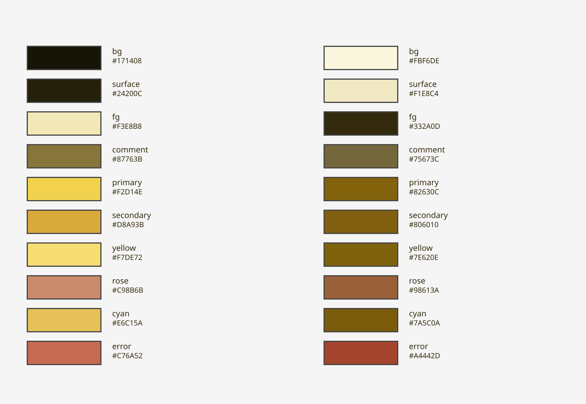
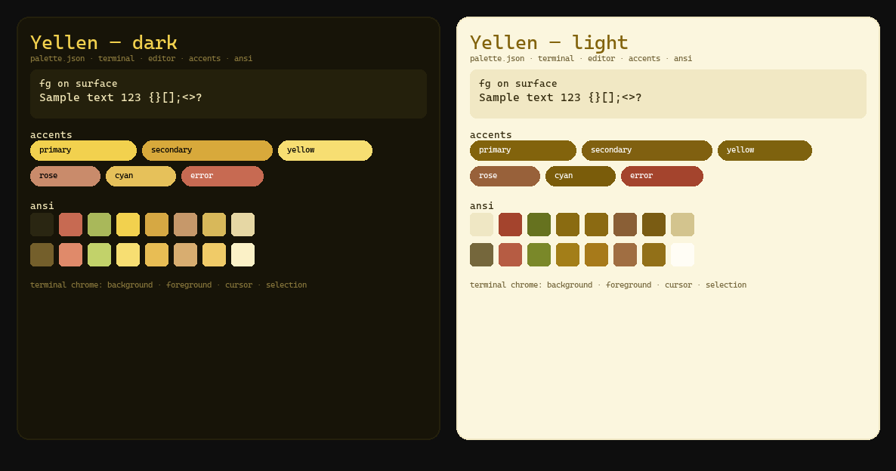

<h1 align="center"></h1>


Golden-yellow terminal, editor, and shell theme family. Warm neutrals, sharp gold accents, and a coherent palette for every supported app.

**Generated theme family.** Every artifact is rendered from a single `palette.json` by `gen.py` (stdlib only). Run `make gen` to regenerate, `make check` to verify no drift.

**[Open the theme gallery →](https://mark44928.github.io/Yellen/gallery.html)** — dark/light swatches, terminal preview and every supported app in one offline page.

Handy generator commands:

```bash
make gen-only APP=vim   # regenerate only artifacts whose path contains "vim"
make list-artifacts     # print every generated path (for dotfile scripts)
```

Two variants: **Dark** (`yellen`) and **Light** (`yellen-light`).

## Preview





Dark (left panel) and light (right panel) render side by side in both images: `palette-preview.svg` is generated by `make preview` (stdlib-only, `scripts/svgswatch.py`), `palette.png` by `scripts/swatch.py`. Both read `palette.json`, so the docs cannot drift from the palette.

WCAG AA: dark fg/bg = 14.95:1, light fg/bg = 13.09:1 (regenerated by `make contrast`; see [palette.md](palette.md)).

## How it works

| File | Purpose |
|------|---------|
| `palette.json` | Single source of truth — all color values, both variants |
| `gen.py` | Stdlib-only renderer; reads `palette.json`, renders every artifact |
| `templates/*.tmpl` | One template per app format |
| `Makefile` | `make gen` renders all artifacts; `make check` regenerates + regenerates the WCAG contrast table + `git diff --exit-code` + the Vim colorscheme load test |

**Byte-identical proof:** `make check` leaves `git diff` empty — generated output matches the committed files exactly, proving the templates faithfully reproduce the theme family. The WCAG contrast table in `palette.md` is generated by `make contrast` (`tests/contrast.py`), so changing a color in `palette.json` can never leave a stale documented ratio behind.

## Quick Install

### One-command installer

The installer detects supported apps, backs up any existing theme files, and
copies the matching variant. It never edits your main app configs — it prints
the one include/theme line to add instead.

```bash
bash install.sh                     # interactive, dark by default
bash install.sh --light --all       # light variant, every detected app
bash install.sh --only termux,kitty,vim
bash install.sh --list              # show detected targets
bash install.sh --all --dry-run     # preview copies
bash install.sh --uninstall         # remove files recorded by the installer
```

Replaced files are backed up; the installer records what it wrote in
`$XDG_STATE_HOME/<theme>/installed.tsv` so uninstall never deletes a file you
edited (use `--force` to override).

### Neovim

**lazy.nvim** — this is the whole setup:

```lua
{
  "Mark44928/Yellen",
  lazy = false,
  priority = 1000,
  opts = {},
  config = function(_, opts) require("yellen").setup(opts) end,
}
```

For the light variant set `opts = { variant = "light" }`.

**vim.pack** (Neovim 0.12+):

```lua
vim.pack.add({ "https://github.com/Mark44928/Yellen" })
require("yellen").setup()
```

**Vim (manual runtime):**

```bash
git clone https://github.com/Mark44928/Yellen.git
cp Yellen/colors/yellen.vim ~/.vim/colors/
cp Yellen/colors/yellen-light.vim ~/.vim/colors/
```

```vim
set termguicolors
colorscheme yellen
```

**Screenshots:** see the generated palette preview above; it is the source-accurate view of both variants.

### Terminal emulators
**Kitty**
```bash
cp extras/kitty.conf ~/.config/kitty/yellen.conf
# add to kitty.conf:  include yellen.conf
# light variant:      cp extras/kitty-light.conf ~/.config/kitty/yellen-light.conf
```

**Alacritty**
```bash
mkdir -p ~/.config/alacritty/themes
cp extras/alacritty.toml ~/.config/alacritty/themes/yellen.toml
# add to alacritty.toml:  import = ["~/.config/alacritty/themes/yellen.toml"]
```

**Ghostty**
```bash
cp extras/ghostty ~/.config/ghostty/yellen
# add to config:  include = ~/.config/ghostty/yellen
# light variant:  cp extras/ghostty-light ~/.config/ghostty/yellen-light
```

**WezTerm**
```bash
cp extras/wezterm.lua ~/.config/wezterm/yellen.lua
# in ~/.wezterm.lua:  require("yellen")
```

**iTerm2**
Open iTerm2 → Preferences → Profiles → Colors → Color Presets → Import → select `extras/yellen.itermcolors` (or `extras/yellen-light.itermcolors` for the light variant).

**Windows Terminal**
Import `extras/windows-terminal.json` via **Settings → Color schemes → Import**.

**Termux**
```bash
cp termux/yellen-dark.properties ~/.termux/colors.properties && termux-reload-settings
# light variant:
cp termux/yellen-light.properties ~/.termux/colors.properties && termux-reload-settings
```

### Shell & prompt

**Emacs** (`yellen-dark-theme.el` / `yellen-light-theme.el`)
```elisp
;; ~/.emacs.d/init.el or ~/.emacs
(add-to-list 'custom-theme-load-path "$HOME/Yellen/emacs")
(load-theme 'yellen-dark t)   ;; or 'yellen-light
```

**Fish shell** (`yellen-dark.theme` / `yellen-light.theme`)
```fish
# Install via fish_config → select "Yellen dark" / "Yellen light"
# Or set manually:
cp fish/yellen-dark.theme ~/.config/fish/themes/
fish_config
```

**Powerlevel10k** (`yellen-dark.zsh` / `yellen-light.zsh`)
```zsh
source "$HOME/Yellen/powerlevel10k/yellen-dark.zsh"
# or: source "$HOME/Yellen/powerlevel10k/yellen-light.zsh"
```

**git** (`yellen-dark.config` / `yellen-light.config`)
```ini
# ~/.gitconfig
[include]
    path = "$HOME/Yellen/git/yellen-dark.config"
```

**git-delta** (`yellen-dark.config` / `yellen-light.config`)
```ini
# ~/.gitconfig
[include]
    path = "$HOME/Yellen/delta/yellen-dark.config"
[delta]
    features = yellen-dark   # or yellen-light
```

**lsd** (`yellen-dark.colors.yaml` / `yellen-light.colors.yaml`)
```yaml
# ~/.config/lsd/config.yaml
color:
  theme: custom
```
```bash
cp lsd/yellen-dark.colors.yaml ~/.config/lsd/colors.yaml
```

**exa** (`yellen-dark.colors` / `yellen-light.colors`)
```bash
export EXA_COLORS="$(cat exa/yellen-dark.colors)"
```

**ripgrep** (`yellen-dark.rc` / `yellen-light.rc`)
```bash
export RIPGREP_CONFIG_PATH="$HOME/Yellen/ripgrep/yellen-dark.rc"
```

**less** (`yellen-dark.termcap` / `yellen-light.termcap`)
```bash
. "$HOME/Yellen/less/yellen-dark.termcap"
```

**fastfetch** (`yellen-dark.jsonc` / `yellen-light.jsonc`)
```bash
cp fastfetch/yellen-dark.jsonc ~/.config/fastfetch/config.jsonc
# light variant:
cp fastfetch/yellen-light.jsonc ~/.config/fastfetch/config.jsonc
# or load directly:
fastfetch -c fastfetch/yellen-dark.jsonc
```

**yazi** (`yellen-dark.toml` / `yellen-light.toml`)
```bash
cp yazi/yellen-dark.toml ~/.config/yazi/theme.toml
# light variant:
cp yazi/yellen-light.toml ~/.config/yazi/theme.toml
```

**helix** (`yellen-dark.toml` / `yellen-light.toml`)
```bash
cp helix/yellen-dark.toml ~/.config/helix/themes/yellen-dark.toml
# light variant:
cp helix/yellen-light.toml ~/.config/helix/themes/yellen-light.toml
# then in ~/.config/helix/config.toml:  theme = "yellen-dark"
```

**lazygit** (`yellen-dark.yml` / `yellen-light.yml`)
```bash
cp lazygit/yellen-dark.yml ~/.config/lazygit/yellen-dark.yml
# light variant:
cp lazygit/yellen-light.yml ~/.config/lazygit/yellen-light.yml
# then: lazygit --use-config-file ~/.config/lazygit/config.yml,~/.config/lazygit/yellen-dark.yml
```

**nano** (`yellen-dark.nanorc` / `yellen-light.nanorc`)
```bash
cp nano/yellen-dark.nanorc ~/.config/nano/nanorc
# light variant:
cp nano/yellen-light.nanorc ~/.config/nano/nanorc
# or add to ~/.nanorc:  include ~/.config/nano/nanorc
```

**zellij** (`yellen-dark.kdl` / `yellen-light.kdl`)
```bash
mkdir -p ~/.config/zellij/themes
cp zellij/yellen-dark.kdl ~/.config/zellij/themes/
# light variant:
cp zellij/yellen-light.kdl ~/.config/zellij/themes/
# then in ~/.config/zellij/config.kdl:  theme "yellen-dark"
```

**vivid** (`yellen-dark.yml` / `yellen-light.yml`) — included in 1.0.0
```bash
# print the LS_COLORS theme for the current shell
vivid generate vivid/yellen-dark.yml
# or apply it for the session:
eval "$(vivid generate vivid/yellen-dark.yml)"
# preview a directory without changing anything:
vivid apply vivid/yellen-dark.yml -V
```

**foot** (`yellen-dark.ini` / `yellen-light.ini`) — included in 1.0.0
```bash
cp foot/yellen-dark.ini ~/.config/foot/foot.ini
# light variant, or keep both and include one:
#   include=~/.config/foot/yellen-light.ini
```

### Syntax highlighting & tools

**bat** (`yellen-dark.tmTheme` / `yellen-light.tmTheme`)
```bash
mkdir -p "$(bat --config-dir)/themes"
cp bat/yellen-dark.tmTheme "$(bat --config-dir)/themes/"
bat cache --build
bat --theme Yellen-dark file.rs
# light: bat --theme Yellen-light
```

**fzf** (`yellen-dark.sh` / `yellen-light.sh`)
```bash
. "$HOME/Yellen/fzf/yellen-dark.sh"
# or add to ~/.zshrc / ~/.bashrc
```

**dircolors** (`yellen-dark` / `yellen-light`)
```bash
eval "$(dircolors -b dircolors/yellen-dark)"
# light: eval "$(dircolors -b dircolors/yellen-light)"
```

**starship** (`yellen-dark.toml` / `yellen-light.toml`)
```bash
cp starship/yellen-dark.toml ~/.config/starship.toml
# light: cp starship/yellen-light.toml ~/.config/starship.toml
```

**tmux** (`yellen-dark.conf` / `yellen-light.conf`)
```bash
tmux source-file "$HOME/Yellen/tmux/yellen-dark.conf"
# light: tmux source-file "$HOME/Yellen/tmux/yellen-light.conf"
```

**btop** (`yellen-dark.theme` / `yellen-light.theme`)
```bash
cp btop/yellen-dark.theme ~/.config/btop/themes/
# set color_theme = "yellen-dark" in btop.conf
```

**micro** (`yellen-dark.micro` / `yellen-light.micro`)
```bash
mkdir -p ~/.config/micro/colorschemes
cp micro/yellen-dark.micro ~/.config/micro/colorschemes/
# in micro: set colorscheme yellen-dark
# light: cp micro/yellen-light.micro ~/.config/micro/colorschemes/
```

## Verify the Colorscheme

```bash
# Dark variant — Normal must show guifg/#F3E8B8 guibg/#171408, name prints 'yellen'
vim -u NONE -N -c "set t_Co=256 rtp+=$HOME/Yellen" \
    -c "colorscheme yellen" -c "hi Normal" -c "echo g:colors_name" -c "qa!"

# Light variant — Normal must show guifg/#332A0D guibg/#FBF6DE, name prints 'yellen-light'
vim -u NONE -N -c "set t_Co=256 rtp+=$HOME/Yellen" \
    -c "colorscheme yellen-light" -c "hi Normal" -c "echo g:colors_name" -c "qa!"
```

## Generator workflow

```bash
make gen       # render every artifact from palette.json
make check     # regenerate, regenerate the WCAG table, fail on git diff (drift detection), load the scheme in Vim
```

## Palette

| Role | Dark | Light |
|------|------|-------|
| bg | `#171408` | `#FBF6DE` |
| surface | `#24200C` | `#F1E8C4` |
| fg | `#F3E8B8` | `#332A0D` |
| comment | `#87763B` | `#75673C` |
| primary | `#F2D14E` | `#82630C` |
| secondary | `#D8A93B` | `#806010` |
| yellow | `#F7DE72` | `#7E620E` |
| rose | `#C98B6B` | `#98613A` |
| cyan | `#E6C15A` | `#7A5C0A` |
| error | `#C76A52` | `#A4442D` |

## ANSI 16-Color Table

| Var | Dark | Light |
|-----|------|-------|
| color0 | `#2A2612` | `#EFE7C4` |
| color1 | `#C76A52` | `#A4442D` |
| color2 | `#A9B85A` | `#66721F` |
| color3 | `#F2D14E` | `#8A6B11` |
| color4 | `#D6A843` | `#8B6A12` |
| color5 | `#C6986A` | `#8A5F36` |
| color6 | `#D8B85A` | `#7A5C13` |
| color7 | `#E6D7A4` | `#D3C48E` |
| color8 | `#745F2B` | `#75673C` |
| color9 | `#E08A6A` | `#B65C43` |
| color10 | `#C2D26A` | `#7A8829` |
| color11 | `#F7DE72` | `#A37E18` |
| color12 | `#E8BD54` | `#A77A1A` |
| color13 | `#D8AD70` | `#A06E42` |
| color14 | `#F0CB68` | `#927018` |
| color15 | `#FBF1C7` | `#FFFDF5` |

## Contributing

See [CONTRIBUTING.md](CONTRIBUTING.md) for adding terminal emulators, changing the palette, and submitting PRs.

**The generator rule:** change a color only in `palette.json`, then `make gen && make contrast` — `gen.py` propagates to every generated artifact (`colors/`, `termux/`, `extras/`, `templates/` outputs). Only `README.md`, `palette.md` prose, and `assets/palette-preview.svg` (`make preview`) are maintained by hand and updated in the same commit.


## 🛠️ More from Mark44928

Tiny, dependency-free tools from the same family:

- [Pythonator](https://github.com/Mark44928/Pythonator) — Python rewrite of Plusalator — stdlib-only, `--eval`/`--json`
- [Solvamath](https://github.com/Mark44928/Solvamath) — terminal math puzzle game — seven puzzle types, daily seed, achievements
- [Bluney](https://github.com/Mark44928/Bluney) — blue-injected theme family — dark + light, single palette.json
- [Fluffless Prompt](https://github.com/Mark44928/FlufflessPrompt) — quiet Oh My Zsh theme — Git state, exit codes, clock
- [Weatui](https://github.com/Mark44928/Weatui) — friendly Open-Meteo weather TUI — saved cities, forecasts, no API key
- [Mark44928](https://github.com/Mark44928) — profile and project index
- [plusafetch](https://github.com/Mark44928/plusafetch) — C++23 fetch for Termux — ~23 ms, zero subprocesses on the default path
- [Plusalator](https://github.com/Mark44928/Plusalator) — C++17 calculator REPL — Qalculate-flavored, ghost autosuggest, 19 themes
- [GrubBlastersHTML](https://github.com/Mark44928/GrubBlastersHTML) — Turn-based artillery in one HTML file — 73 weapons, fully destructible terrain
- [SnakTUI](https://github.com/Mark44928/SnakTUI) — Snake game for the terminal — Textual + Python
- [Easy-Termux-Package-Manager](https://github.com/Mark44928/Easy-Termux-Package-Manager) — fzf-driven package manager for Termux — snapshots, audit, 194 tests
- [NoNameOS](https://github.com/Mark44928/NoNameOS) — OS simulation in a single C++17 file — virtual FS, real shell
- [CalculaHTML](https://github.com/Mark44928/CalculaHTML) — static HTML calculator — 16 themes + System mode, zero deps
- [android12-fastfetch](https://github.com/Mark44928/android12-fastfetch) — fastfetch config for Android 12 + native X11 Termux desktops
- [debloat-android-tv](https://github.com/Mark44928/debloat-android-tv) — ADB debloat for rooted Android 9+ TV sticks & boxes
- [Android9-audios](https://github.com/Mark44928/Android9-audios) — 217 stock Android 9 system sounds + per-file SHA-256

## License

[MIT](LICENSE)
