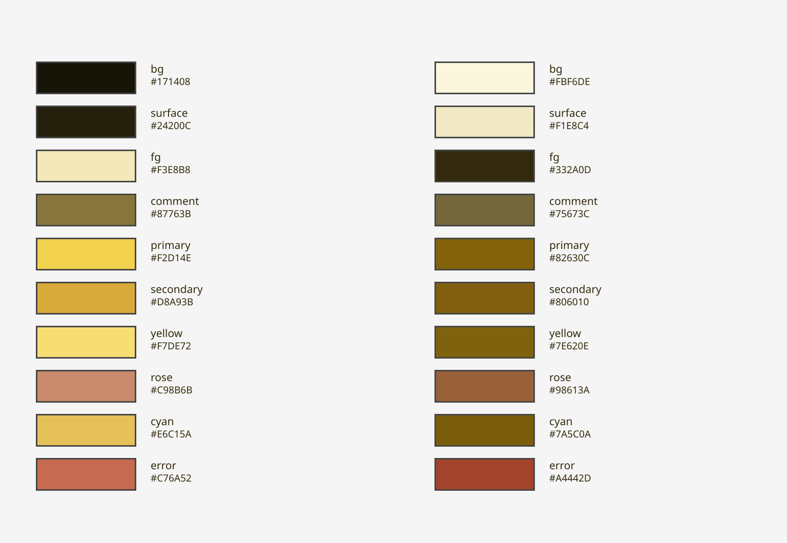

# Yellen Palette

Yellen is a golden-yellow theme family for terminals, editors and shells.
Neutrals lean warm; yellow is the signal color. Two variants: **Dark** and **Light**.



## WCAG Contrast (measured)

| Variant | Pair            | Ratio | Pass AA |
|---------|-----------------|-------|---------|
| Dark    | fg / bg         | 14.95 | yes     |
| Dark    | primary / bg    | 12.29 | yes     |
| Dark    | secondary / bg  |  8.47 | yes     |
| Dark    | error / bg      |  4.92 | yes     |
| Dark    | rose / bg       |  6.48 | yes     |
| Dark    | cyan / bg       | 10.65 | yes     |
| Dark    | yellow / bg     | 13.72 | yes     |
| Dark    | comment / bg    |  4.11 | no*     |
| Dark    | color0 / bg     |  1.21 | no*     |
| Dark    | color8 / bg     |  3.00 | no*     |
| Light   | fg / bg         | 13.09 | yes     |
| Light   | primary / bg    |  5.17 | yes     |
| Light   | secondary / bg  |  5.37 | yes     |
| Light   | error / bg      |  5.62 | yes     |
| Light   | rose / bg       |  4.71 | yes     |
| Light   | cyan / bg       |  5.75 | yes     |
| Light   | yellow / bg     |  5.31 | yes     |
| Light   | comment / bg    |  5.14 | yes     |
| Light   | color0 / bg     |  1.14 | no*     |
| Light   | color8 / bg     |  5.14 | yes     |

\* The main **fg/bg** pair passes AA. Comment levels are intentionally quieter.
The light accent ratios are limited by the pale background, so light accents
are meant for large text and UI chrome.

## Dark Variant — `#171408`

| Role       | Hex       | Notes             |
|------------|-----------|-------------------|
| bg         | #171408   | warm charcoal      |
| surface    | #24200C   | lifted umber       |
| fg         | #F3E8B8   | warm cream         |
| comment    | #87763B   | muted ochre        |
| primary    | #F2D14E   | signal yellow      |
| secondary  | #D8A93B   | deep gold          |
| yellow     | #F7DE72   | bright gold        |
| rose       | #C98B6B   | clay               |
| cyan       | #E6C15A   | amber              |
| error      | #C76A52   | burnt coral        |

## Light Variant — `#FBF6DE`

| Role       | Hex       | Notes             |
|------------|-----------|-------------------|
| bg         | #FBF6DE   | warm paper         |
| surface    | #F1E8C4   | parchment          |
| fg         | #332A0D   | dark coffee        |
| comment    | #75673C   | faded ink          |
| primary    | #8E6D10   | dark gold          |
| secondary  | #9E7B16   | bronze             |
| yellow     | #A8871C   | dark yellow        |
| rose       | #98613A   | toasted clay       |
| cyan       | #8A6B12   | antique gold       |
| error      | #A4442D   | deep rust          |

## ANSI 16-Color Table

Yellen keeps the conventional ANSI slot layout and tints every slot warm.
The exact values for both variants live in [`palette.json`](palette.json);
every artifact and this document are derived from that file.

## Regenerate

```bash
make gen       # regenerate all 64 artifacts
make contrast  # recompute the WCAG table
make preview   # regenerate the SVG palette preview
make check     # drift + color-load gate
```
